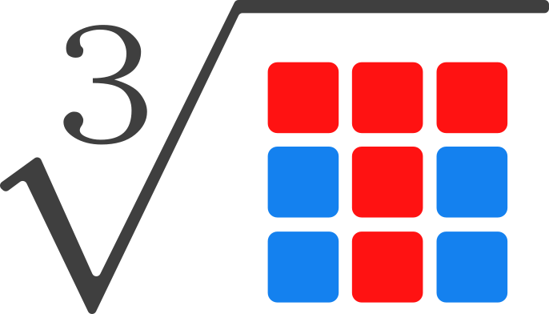

<div align="center">

<picture>
  <source media="(prefers-color-scheme: dark)" srcset="./core/packages/client/public/icons/CubeRoot-mark-dark.svg">
  
</picture>

# [CubeRoot](https://cuberoot.me/en)

Time your solves, train algorithms, explore WCA stats, and solve puzzles in your browser.

</div>

[Cubing Lean](./research/cubing-lean/README.md) collects machine-checked proofs about cube diameter and the Rubik’s Cube group. [Contribute a proof or review a model](./research/cubing-lean/CONTRIBUTING.md).

## Local development

Use the Node.js version in [`.node-version`](./.node-version) and the pnpm version in [`core/package.json`](./core/package.json). Run these commands from the repository root.

```sh
cd core
pnpm install --frozen-lockfile
pnpm --filter @cuberoot/client dev
```

Open [127.0.0.1:3000](http://127.0.0.1:3000/). The local Web app proxies `/v1/*` requests to the production API by default.

[Setup guide](./docs/contributing/local-setup.md) · [Development and checks](./docs/contributing/development.md) · [Contributing](./CONTRIBUTING.md)

## Architecture

| Area | Where to look |
| --- | --- |
| Web | [`core/packages/client`](./core/packages/client/README.md) · Next.js |
| API | [`core/apps/api`](./core/apps/api/README.md) · Hono and PostgreSQL |
| Apps | [App platform guide](./docs/product/apps/README.md) · mobile, desktop, and mini programs |
| Solvers | [`solver/`](./solver/README.md) · Rust and WebAssembly |
| Data | [`core/jobs/`](./core/jobs/) · WCA statistics and data pipelines |

[Documentation index](./docs/README.md)

## Credits

[Open-source acknowledgments](https://cuberoot.me/en/support)

## License

[GNU GPL v3](./LICENSE). Vendored components retain their original licenses.
