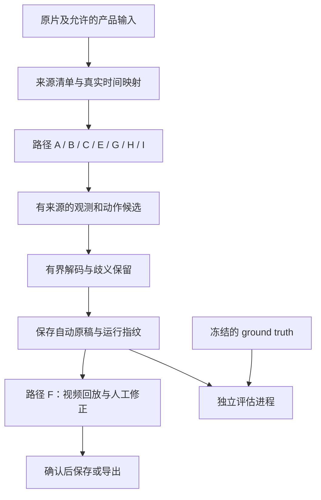

# 视频自动复盘：完整实施方案与九条实现路径

这份方案回答：最终产品是什么、有哪些从视频到复盘的完整实现路径、每条要训练什么、代码怎样落地、需要什么 ground truth，以及何时继续或换路线。建议以 **A「可见实例与物理搜索」为算法主线，F「交互修正」为产品交付方式**；C 是数据条件合适时的主要学习型备选。B、D、E 要有具体瓶颈证据才投入；G、H 提供不同拍摄/硬件条件下的独立产品；I 先作为探索和审核工具。“完整”指覆盖当前主要技术家族及交付环节，不声称穷尽所有可能算法。

日期：2026-10-24。依据仓库现有实现、失败记录及一手资料。这里的架构和优先级是本项目的设计判断，不是任何论文或竞品已证明的组合。本轮只写方案、阅读源码，不运行测试、typecheck、模型、训练或性能试验，不增加依赖或发布服务。

- 本文是**系统实施方案**；[technical-options.md](technical-options.md) 是 25 类组件的选择依据和历史失败清单。
- [plan.md](plan.md) 保存阶段 A–D 的研究门槛与历史演进；[README](README.md) 维护当前实际可调用接口。
- [实现记录](reports/2026-10-24-design-and-integration.md) 区分已经写入的代码与缺口。本文写“拟新增”“应实现”的模块均为后续设计，不能当成已有能力。

## 1. 最终要交付什么

用户提供三阶速拧视频，选取大致魔方区域和起止范围，可选提供独立打乱。系统输出实际执行的动作顺序、可核实的动作完成时间或区间、备选解释和需要修正的位置。用户可同步看视频与魔方回放，修改少量错误，然后保存或导出。

第一产品模式面向普通单目视频、已知独立打乱。目标规格是 1080p、每秒 50 个真实时间采样帧；主质量目标是逐视频等权序列分数至少 80%。10 秒视频处理 20–40 秒是质量通过后争取的体验目标，尚未实测达到。不是 80% 视频整把全对，也不保证任意角度都可识别。

**信息不足时没有算法能保证唯一恢复。** 完全遮挡下的 `R R'` 和未转动可能拥有同样端点；只看端点无法确定 `U U` 与 `U2` 的真实事件划分、半转的实际方向或未拍到的转体。恢复初态也不能恢复拍摄前真实用过的打乱历史。系统应保留歧义、返回局部结果或请求一项补充证据，不能让语言先验或最短解伪装成观测。

### 1.1 四种初末状态条件

| 输入条件 | 合理算法和输出 | 交付顺序与当前状态 |
| --- | --- | --- |
| 独立初态已知，终态确认复原 | 双端物理约束，输出完整候选轨迹 | 首个目标；现有新入口只在人工边界等受限条件下写有实现，未运行 |
| 独立初态已知，终态未知或未复原 | 前向状态过滤，末帧只提供可见的部分约束，输出估计末态 | 第二种状态合同；不得强制补到 solved，现入口未支持 |
| 初态未知，终态确认复原 | 从复原端逆推；或先从观察期建立初态候选再双端搜索 | 单独验收；不能由 GT 解法反推初态，现入口未支持 |
| 初末态均未知 | 联合恢复部分状态、姿态与动作；必要时请用户提供一个可验证状态锚点 | 研究版本；可能存在多个合法解释，现入口未支持 |

人工几何、人工逐步边界、多视角和智能魔方日志是另外的输入维度，应与上述四种条件组合记录。用户框 ROI、选视频范围，与提供逐步答案不是同一种帮助。

### 1.2 动作和时间的共同合同

初期支持集合按真实素材冻结：基本层转、宽转、整体转体，以及实际出现的同时动作。物理引擎支持某记号，不等于推理词表已覆盖它；当前词表还没有任意组合及全部中间层事件。未支持动作必须报告，不能改写为更常见的短解。

原始记谱、供播放器使用的物理记谱、评价单位分别保留。只允许预先约定的拼写规范化；不能消掉 `U U'`、合并事件或把宽转改写成转体加单层转后提高主分。`UD'` 等同时动作保留复合事件及分量，不为凑串行序列虚构先后。旧末尾人工朝向校正另存，不当作视频动作。

完成时间是层转动完成的时间，不是手开始动、模型概率峰或人工片段后端点。时间倍率未核实时可设计“仅动作序列”的结果，但必须明确时间未验证；当前独立入口更保守，会拒绝缺少核实时间的事件。这项放宽需要后续实现，不能改字段冒充已支持。

## 2. 九条路径的整体比较

下表的投入是相对当前仓库的工程判断，不是工期、训练小时数或成功概率。A–E、I 是识别架构选择；F 是可与它们结合的产品路径；G、H 改变输入条件，不能与单目自动结果混算。

| 路径 | 完整处理链 | 主要监督/额外输入 | 工程 / 数据 / 算力 | 何时选择 |
| --- | --- | --- | --- | --- |
| **A 可见实例与物理搜索** | 分割读色 → 几何/中心 → 时间事件 → 物理轨迹 → 修正 | 可见实例、几何、完成时间，动作 GT 用于验收 | 中高 / 中高 / 中 | 当前主线，适合逐层定位错误 |
| **B 关键点与分层运动** | 可见点跟踪 → 整体姿态/层运动分离 → 转动事件 → 状态过滤 | 点轨迹、可见性、层身份、部分姿态及时间 | 高 / 高 / 中高 | 正确读色仍无法对应，或颜色极不稳定而结构清楚 |
| **C 连续视频动作转写** | 视频编码 → 时序模型 → 动作序列 → 物理重排/时间精修 | 多组独立视频的动作序列；时间标签用于时间头 | 中高 / 高 / 中高 | 动作 GT 较多、像素标注不足且场景覆盖够 |
| **D 状态与动作双路融合** | A/B 的状态证据 + C 的动作证据 → 联合解码 | 至少两条已证明有效的证据、验证集校准 | 高 / 高 / 高 | 两路错误互补，单路都已有独立收益 |
| **E 合成训练与分层渲染** | E1 合成标签 → 前端预训练；E2 候选动作/姿态 → 渲染比对 → 重排 | 几何、遮挡、相机/曝光参数及真实校准短片 | 高至很高 / 高 / 高至很高 | 可模拟的具体缺口持续出现，或渲染短窗上限支持 |
| **F 交互式约束复盘** | 自动候选 → 少量人工锚点 → 局部重算 → 确认导出 | 用户按需确认可见颜色、几何或动作 | 中 / 可渐进 / 低中 | 优先建立可使用的助手和标注闭环 |
| **G 多视角复盘** | 同步多机位 → 跨视角观测/几何 → 轨迹 → 修正 | 多机位、同步/标定及对应标签 | 高 / 采集高 / 中高 | 愿意规范拍摄，遮挡是单目主要瓶颈 |
| **H 智能魔方与视频** | 原始动作日志 → 时钟对齐 → 视觉补转体/异常 → 回放 | 智能魔方原始日志与同步视频 | 中 / 采集中 / 低中 | 新录制训练数据、硬件辅助复盘产品 |
| **I 视频大模型直接提案** | 短窗视频 → 结构化提案 → 可见证据/物理核对 → 修正 | 可用视频模型、固定评价样本；可能有外部推理费用 | 接线低、质量控制高 / 评价必需 / 待测 | 低成本探索或局部审核，不作当前质量承诺 |

## 3. 所有路径复用的基础

训练过程可以使用训练组 GT；图中的隔离约束针对推理与事后评分。测试答案不能进入观测生成、候选构造、停止条件或初态推断。

| 层 | 当前可复用代码 | 后续共同工作 |
| --- | --- | --- |
| 原片与标签 | `src/dataset-manifest.ts`、`scripts/dataset-audit.ts` | 接收 GT、版本审核、分组冻结，建立多任务标注关联 |
| 时间/图像 | `scripts/prepare-video-frames.ts`、`vision/dataset.py` | 用真实源验证 PTS、显示旋转、慢放与重复帧；目前提帧 partial 尚无自动续提 |
| 单帧模型 | `vision/baseline.py`、`vision/metrics.py` | 真实实例训练与验证；增加独立中心/几何监督需版本化 |
| 稀疏几何 | `src/visible-geometry.ts` | 自动几何生产器、跨面共同姿态、遮挡重定位 |
| 时序 | `src/observation-timeline.ts` | 现仅变化区间；补完成时间模型及可合并/拆分的事件候选图 |
| 物理与搜索 | `src/rotation-perms.ts`、`src/anchored-search.ts`、`src/independent-reconstruction.ts` | 泛化初末态合同、自动时间候选搜索、词表覆盖与校准 |
| 输出/验收 | `scripts/reconstruct-observations.ts`、`src/evaluation.ts` | 保留局部结果与人工版本，增加按失败类型统计，校准接受/拒判策略 |

未来的关键合同应覆盖：原片/帧 ID 与哈希、PTS/真实时间、几何来源、动作候选区间、模型与代码版本、辅助模式、拒判原因、自动原稿、人工修订及审核状态。当前 v1 文件没有的字段必须通过版本迁移加入；不能把本文的未来合同直接传给严格 v1 parser。

几何模型与动作模型输出“观测/提案”，物理引擎输出“合法候选”，人工作出“确认”，三者不共用一个成功标志。`completed` 目前只是启发式门槛通过，仍有 `qualityVerified: false`。

## 4. 路径 A：可见实例、几何对应与物理搜索

### 架构与训练内容

`视频 ROI → 可见实例 mask/颜色 → 面/中心/格位对应 → 完成事件候选 → 已知状态约束搜索 → 动作、时间和歧义`

初期分开三个任务，便于知道错误来自哪里；任务有效后才能考虑共享骨干降低推理成本。

| 任务 | 输入与输出 | 监督与损失设计 |
| --- | --- | --- |
| A1 可见实例 | ROI → 实例 mask、六色类别、可读性 | 真实可见 mask、颜色、未知区域；当前 Mask R-CNN 基线保留，未知区域的损失屏蔽尚需补全 |
| A2 几何和中心 | ROI/实例特征 → 面角点、中心身份、实例到面归属、层对齐/可见性 | 独立角点/面归属/中心标签；已知项才计算坐标/分类损失，不用 GT 状态反投填满遮挡角点 |
| A3 时间事件 | 连续 ROI 特征与几何 → 层活动、对齐状态、完成候选/区间 | 完成时间或区间、连续转动/整体转体/遮挡标签；未知时段屏蔽相应损失，不作为静止负例 |

TorchVision 的实例检测微调接口支持目标框、类别和实例 mask；它不自动提供本项目需要的中心身份、面角点和完成时间头。这些是新增设计。[官方微调教程](https://docs.pytorch.org/tutorials/intermediate/torchvision_tutorial.html)

### 推理如何接起来

1. 保留每个真实解码帧，使用有限 ROI 及上下文。模型只读实际可见区域，不强制输出 54 格。
2. A2 产生有可见性和不确定性的面几何；只在层对齐的可用区域做单应投影。动态层期间保留局部观测，不能把活动层硬塞成整面平面。
3. 将整体持握姿态与贴纸状态分开。相邻中心结合面几何约束离散朝向；两点颜色本身不确定连续 6DoF。跨面候选必须能由共同姿态解释，不能各自自由挑一个最吻合状态的朝向。
4. A3 产生多个完成候选，构建时间节点与候选事件边。边允许转体、单层/宽转、约定的同时动作；一个变化窗可能需要拆成多事件，多个运动峰也可能属于一次半转。
5. 搜索节点含时间、物理状态、有限姿态假设及路径身份。沿事件边应用真实置换，以可见颜色、几何和事件分数排序；硬初末态只能来自允许的独立输入。保留多个到达相同状态的不同动作历史。
6. 独立保留时间不明、候选缺口和遮挡区间。事件完成时间由时间模型/拟合得到，不能直接抄区间边缘。输出经校准的接受结果与候选复核项。

### 分步代码工作

- 继续复用 `vision/baseline.py`，先完成一个可见实例基线。当前会拒绝含 ignore 区域的训练帧；需真正屏蔽未知区域的提议框、分类和 mask 损失，或使用经过审核的有效裁剪。仅改标注字段不能解除这个限制；只选清楚帧也会造成覆盖偏差。
- 拟在现有 `vision/` 研究边界中增加面几何/中心预测和时序任务；这些模型尚不存在。先独立实现和记录各自 checkpoint，再决定是否共享特征。
- 扩展 `visible-geometry.ts` 的上游生产与共同姿态校验。几何标签关联帧和可见实例，保存角点/边、面归属、中心身份与可见性；未知项填 null，不回填遮挡位置。预测另带帧级共同姿态假设编号和拟合残差。现有 sidecar 是诊断接口，不是自动几何算法。
- 将 `observation-timeline.ts` 的变化提案接到**拟新增**的时间事件候选图；扩展现有搜索处理可变事件数，不能把每个候选峰直接固定为一步。
- 扩展请求/搜索的末态合同，使已知初态的前 5–10 步短片能够前向输出估计末态；现入口要求复原终态，不能用整把打乱加 GT 中间态伪造独立短片测试。

**可交付顺序：** 人工几何/边界诊断 → 自动几何、人工边界 → 自动几何/边界的短片 → 整把自动稿＋F 修正。每去掉一种人工辅助就单独评分。

**历史失败的实质改进：** 独立像素与几何监督替换错位网格，不再在衣服/手的像素上调 HSV；完成标签替换手部运动峰；候选覆盖和绝对视觉支持替换“能还原就算对”。正确观测仍不能改善动作时，停止扩大 A1 标注，先查时间、对应、词表和搜索。

## 5. 路径 B：关键点、可见轨迹与分层三维运动

`视频 → 可见角点/边/色块内点 → 遮挡感知跟踪 → 整体姿态与活动层相对角度 → 完成事件 → 状态过滤`

这条路线降低对逐帧准确读色的依赖，但仍需要足够纹理、几何与面身份锚点；它不是“完全不用颜色”。整体魔方是活动层结构，不能用一个刚体姿态解释全部像素。

**监督和训练：** 可见点身份、逐帧可见性、点所属面/层、中心或清晰帧身份、转动完成区间；可选可信姿态/层角标签。训练点/角检测器与重关联、可见性或层归属模型；已有通用点跟踪器只作为可验证的候选基础。CoTracker 提供轨迹与可见性输出，但不会识别魔方层动作；官方仓库注明主要内容采用 CC-BY-NC，因此不能直接假定它可作为商业部署依赖。[CoTracker 官方仓库](https://github.com/facebookresearch/co-tracker)

实例编号、连续轨迹编号和物理块身份分别记录，不能因为两个点颜色相同就连成同一轨迹。相机内参未知时保留有限参数假设或明确受限的投影模型；单目估计深度不是独立量测。姿态 GT 须来自独立标定或明确标记的合成数据，不能由测试动作反投后充当图像真值。

**具体算法：** 先用可信静止/未参与转动的点拟合整体姿态，再比较剩余点对有限层转模型的残差；保留多个轴、层、方向与角度假设。跨越相邻面的点沿三维表面解释，不把面外流入当平面条带平移。达到对齐附近只产生完成候选，半转经过 90° 不自动拆成两步。完全遮挡后重新检测/关联，不能跨越失踪期假定身份延续。

**实现任务：** 增加 `vision/` 的点/轨迹输出适配、轨迹来源和可见性合同；在研究 `src/` 增加整体姿态与层运动候选拟合；转成与 A 相同的事件边和几何证据，再复用物理引擎。现 `observation-timeline.ts` 的面四边形短时关联不是这种轨迹恢复，不能改名复用后宣称已实现。

**最小交付：** 有独立初态、可见层结构的短片，先证明整体转体与单层转能被分开，再加入快速半转、宽转与遮挡。先评价点是否跟到手上、重关联和运动轴错误，再看动作序列。

**重试条件与停止：** 旧 Farneback、灰度条带和晶格位移在周期纹理、面外流入和错误跟踪上失败；新路线必须改变对应、分层模型和遮挡处理。若人工确认的轨迹仍不能区分动作，停止训练更大的跟踪器；若只在慢速清晰片有效，交付范围就限于该条件。

## 6. 路径 C：直接学习连续视频的动作转写

`连续 ROI → 可微调视觉编码器 → 时序卷积/Transformer → CTC 动作序列 → 时间精修与物理候选重排`

**适用数据：** 用户能提供较多独立录制的完整动作序列，却暂时无法逐帧画 mask。它减少像素标注需求，不减少对动作准确性、拍摄多样性和评估隔离的要求。DeepCube 的公开项目面向魔方顺序动作转写，可作任务和数据结构参考；不搬用其未知条件下的成绩。[DeepCube 官方仓库](https://github.com/deep-cube/deep-cube)

**先做一个明确基线：** ROI 视觉编码器＋轻量时序卷积＋CTC；按组划分后先训练头，再有限解冻任务相关视觉层。Transformer 或更大视频骨干只在基线错误说明有必要时替换，不一开始同时扫多套架构。旧实验冻结 ResNet/R3D 特征后分类，不能视为这套任务微调已经失败，也不能用原 229 段支撑任意大模型。

**训练目标：** CTC 学习序列与未精确分段视频的对齐；有完成标签时再加独立完成时间头、可见性/拒判头。局部动作分布可作为辅助损失，但不把 padding、未知动作或遮挡都标为 blank。CTC 的 blank 是对齐符号，并不表示真实世界静止。[CTCLoss 官方文档](https://docs.pytorch.org/docs/stable/generated/torch.nn.CTCLoss.html)

普通 CTC 监督要求一条已审核的目标序列。顺序不明的重叠动作、存在未标注动作的片段不能硬填一个答案；要么按冻结规则组成复合事件，要么先作为待审数据。帧间时间保留实际 PTS，时间头只对具备相应精度的标签计算损失。

**必须处理的细节：** 连续相同标签需要额外对齐位置，不能让时间下采样使目标序列不可表示。10 秒 50 fps 有约 500 帧，若每 8 帧只保留一个输出位置，仅约 63 个位置，可能容纳不了约 90 个动作；应先按真实事件密度选时间步长。不要用把无限损失归零来隐藏不可对齐样本。`U U`、`U2`、半转方向、同时动作的词表定义先冻结，不能让解码规范化自动吞并它们。

**推理和实现：** 复用原片 manifest、时间来源、分组和运行指纹；拟新增序列数据加载、时序模型、CTC prefix beam 和时间对齐输出。动作候选统一转换为事件合同，再由现有物理引擎重排。初末态约束不足时保留多条解释；若物理约束改掉模型输出，记录改前/改后而非只报更漂亮的版本。模型常驻，帧/特征缓存有界，保存已提交前缀和恢复状态。滑窗必须保留重叠区的事件身份和时间，不能通过简单拼接重复/漏掉边缘动作。新增 PyTorch 研究入口需同步科研例外登记和资源守卫。

**最小交付与停止：** 在同输入、同来源分组上输出完整动作序列，分别比较直接转写和物理重排；时间头另验。若只是背熟公式、在相邻帧随机划分上提升，或在新的选手/机位上仍失败，就先补数据/表示证据，不继续加深网络。必须包含错误操作、回拧、重复动作和稀有类，不能只训练“标准漂亮解法”。

## 7. 路径 D：状态证据与动作证据联合解码

`A/B 的可见状态/几何 + C 的局部动作/时序 → 时间-状态-姿态联合候选图 → 多路径输出 → 修正`

仅当两路各自有独立收益且错误互补时开展。多个分数若都来自同一错网格，就不是多份独立证据。旧手部统计与旧概率融合反降，禁止重演“多一个通道必然更准”。

**设计：** 对每条事件边保留颜色/可见性、几何残差、局部动作分数、完成时间分数和先验的分项来源。权重仅由验证集确定；门控选择“哪一路此刻可用”，缺失输入不转成自信反证。物理合法性和独立状态锚是硬约束，CFOP/公式频率仅作软排序，不禁止手滑或非标准执行。

当前 `detectionScore` 是未校准检测分数，不能扩展成六色概率向量；连续重复帧及同一区域派生特征也不能重复计为独立证据。联合解码仍须保留同状态、不同动作历史，姿态变化受连续图像支持约束，不能逐帧自由旋转来迁就错误状态。

**实现路径：** 先做两路固定输出的后融合，仅新增统一候选接口、分项评分和可靠性校准；它有效后再尝试共享骨干或联合训练。可用目标示意为 `J = λv·视觉 + λg·几何 + λa·动作 + λt·时间 + λp·先验`，这只是评分设计，不是已校准概率，也不假定通道独立。随后才考虑将时间、姿态和状态作为联合隐变量的粒子/束搜索或因子图。

**最小交付与停止：** 同一冻结样本比较 A、C、D，包含掉一路输入的情况，检查轨迹改动是否有新图像证据。若融合没有降低编辑距离/人工修正量，或只提高自信却增加错误接受，就保留更简单的单路，不以扩大搜索掩盖融合失败。

## 8. 路径 E：合成训练与分层渲染比对

拆为两条可独立停止的实施支路：**E1 为 A/B/C 提供合成预训练数据；E2 在推理时渲染并重排动作候选。** E1 不要求产品推理中运行渲染器；E2 也不要求先训练合成模型。两者共用魔方运动与相机场景，但收益分别验证。

### E1：合成标签预训练，再用真实资料微调

`物理状态/动作计划 → 连续层运动与拍摄场景 → RGB + 可见标签 → 任务预训练 → 真实标签微调 → 原前端推理`

先为明确缺口生成少量数据，如同色相邻、部分转层、稀有角度、手遮挡和反光。输出可见实例、中心、层角、二维对应及动作时间；可见 mask 通过遮挡关系计算，不用完整投影冒充可见区域。保存场景资产、随机种子、渲染版本、动作计划和合成来源，不能改成 `human-visible`。

摄像机、光照、材质、背景、曝光和速度的范围取自训练资料，不能看保留测试调模拟器。合成内部也隔离动作模板、背景与资产组合。曝光模糊来自曝光期间的运动，不能仅在静态帧上任意加模糊。

**交付与停止：** 比较“仅真实训练”和“合成预训练＋同预算真实微调”，同时报告新增渲染/训练总成本。只在合成资料上提升、真实跨录制退化时，停止扩量并处理域差异。它减少部分像素标注，不能省掉真实标签与独立验证。

### E2：分层渲染候选，与实拍比对

`初始动作/姿态候选 → 带活动层的三维魔方 → 相机/遮挡/曝光渲染 → 与实际可见像素比较 → 局部优化与离散搜索`

这是研究成本最高的路线之一。状态包括离散贴纸排列、连续整体姿态、活动层角度和相机参数；必要时再估计曝光/材质。只对确认属于魔方且可见的区域计算残差，背景和被手遮挡部分不能硬匹配。

**实施顺序：** 先固定人工诊断姿态和有限候选，检验边缘、形状与颜色残差能否区分真/假动作；再只优化连续姿态/时间；有收益后才加入离散动作搜索和曝光积分。相机/材质自由度不能大到能把任何错动作都拟合好，也不能任意扩大遮挡区隐藏残差。连续半转与手腕转动必须分别建模，不能把整枚魔方当刚体。

**代码与训练：** 拟新增研究渲染器、像素变换与遮挡接口、有限差分/可微优化及候选评分适配；复用现有物理置换作为离散状态事实源。检测/姿态网络可提供初始化，也可先完全用诊断输入；不要求另训一个大模型才能开始最小对照。若需要 Blender，按仓库已有科研例外归属实现，不重新引入已迁出的通用 Python 编排。

**与旧失败的区别：** 旧每帧色相/饱和度增益优化失败，仅说明旧 patch 和该光照参数族无效；本路线必须新增可信几何、活动层、遮挡或曝光证据。只把颜色校正改名“可微渲染”不构成重试。

**最小交付与停止：** 给定短窗候选时稳定改善排序，再谈整把。正确姿态、可见性条件下仍分不清动作，或残差总被材质差异支配，就停止扩成全局优化。合成像素逼真也不能证明真实视频动作正确。刚体姿态工作只可作局部参考，不能把 RGB-D 条件直接迁移为单目活动层能力。[FoundationPose 原论文](https://arxiv.org/abs/2312.08344)

## 9. 路径 F：先交付交互式复盘助手

`视频 → 自动原稿/歧义区间 → 用户提供一项局部证据 → 受影响片段重算 → 视频与动作回放 → 确认/导出`

这条路径可以在自动模型未达到最终指标前提供价值，也能产出真实修正数据。它不能替代自动指标验收：自动原稿与人工修好后的结果分开存储、分开评分。

**最小交互：** 导入视频和可选打乱；选范围/粗 ROI；查看同步回放；只对不确定区间询问可见颜色、中心/面对应、完成边界或候选动作。每次询问应说明它区分哪几条路径，不让用户逐帧填满 54 格。撤销人工修改后应恢复相应版本，不静默把修改当成模型新预测。

**实现任务：** 将 `review-queue.json` 转为可定位视频区间的任务；拟新增追加式修订记录，绑定源哈希、帧/事件 ID、原稿版本、修改前后值、审核状态。按用户锚点重算局部区间，周边已有确认约束保持；复用物理引擎而非求一个最短连接就当实际动作。

**项目接入：** 现有 `/frame-count` 已有本地视频、逐帧控制和 split 标记；`/recon` 已用 `ReconPlayerCanvas`、`SolutionView` 展示动作。先抽取其合适的可复用能力，再接研究产物，不复制一套播放器。现有智能魔方 ground-truth 队列与审核流程可借鉴版本/确认规则，但其标签语义不是像素掩码，不能直接当视频实例标注库。

**交付与验收：** 能完整导入、定位问题、编辑、撤销、回放、保存并重新读取；记录每把人工问题数、修正事件数、耗时及最终正确性，与纯人工流程比较。若自动建议使用户更慢，优先减少无效提示和错误高置信输出。尚未审核的用户修改只能是待确认标签，不能自动进入保留测试真值。

## 10. 路径 G：受控多视角视频复盘

`两路或更多同步视频 → 时间/相机校准 → 各视角可见实例与轨迹 → 共同三维对应/状态约束 → 动作与修正`

有两个不同用途，必须分开：辅机只帮助人工标注时，主机推理仍是单目；推理同时使用辅机时，结果就是多视角模式。第一种有助于构建单目训练资料，但辅机看得到、主机看不到的颜色仍不能标为主机可见像素。

**数据与算法：** 每个视频独立保存 PTS、裁剪、曝光与真实时间映射；建立跨相机偏移/漂移和不确定度，不能只用同样帧号配对。先在共同可见区域确认对应，再融合各自可见的约束；同步差大于待识别事件尺度时保留多个时间配对，不能强行三角化。多个视角也可能同时被手挡住。

**实现任务：** 拟增加多源录制组、时钟映射、相机参数和跨视角证据关联；复用 A/B 前端与物理搜索。先做两个固定机位的短片，不一开始支持随手移动的任意多相机。研究中的机器人、多相机和额外传感器条件不是普通视频的效果证明。[OpenAI 魔方机器人论文](https://arxiv.org/abs/1910.07113)

**交付与停止：** 对同一把同时报告单目和多目输入结果、额外设备及同步负担。若多机位仍没有增加可读覆盖或减少轨迹歧义，先调整拍摄条件；不要无限增加模型。只有用户愿意按约定采集时，才把它作为产品主入口。

## 11. 路径 H：智能魔方日志与视频同步

`原始魔方日志 + 视频 → 协议事件/时钟核对 → 视觉补充转体与异常 → 对齐回放及分析`

它既是可独立交付的硬件辅助产品，也能提供训练动作标签。默认采集设备沿用项目约定的 GAN 16 UI；协议、原始日志字段与设备时间能力需在实施时核对，不能假定每台设备完整记录换握/转体或真实完成时刻。

**实现步骤：** 保留未经化简的原始事件和设备/接收时间；用可辨识同步事件拟合视频时间偏移及必要的漂移；检测丢包、重排、断连和对齐残差；将层转日志与视频中的整体姿态关联，恢复人类记谱所需的转体语义。日志与画面冲突时保留冲突，不能直接宣告视觉或日志必然正确。

**训练边界：** 日志可减少层动作顺序标注，但不提供 mask、可见性或面角点。蓝牙接收时间不能直接充当 20 ms 完成时间 GT。只在具备可靠同步、视频可见性审核和清楚事件定义的段上生成相应标签。

**项目接入：** 复用现有智能魔方采集与 [收录工作流](../../docs/recon-intake-workflow.md)，原始数据、人工预期和自动结果分开。现有默认化简解法可能省略视频需要保留的执行细节，视频 GT 应回到原始事件并重新审核，不能直接导入已化简文字。

**交付与停止：** 先交付单设备单视频的可审计同步回放；若同步误差无法支持目标时间精度，仍可交付动作顺序辅助，时间指标单列未通过。没有日志的旧视频不由此路线解决，成绩不计入纯视频自动模式。

## 12. 路径 I：视频大模型提出动作，再独立核对

`固定短窗及相邻上下文 → 视频模型输出结构化候选/证据 → 物理与像素核对 → 人工解决冲突 → 合并片段`

这是完整的探索路径，当前不作为首选生产方案。可能快速形成原型，但“公式看起来合理”风险很高；同一错误回答反复自我检查，不等于新增证据。

**实现设计：** 拟增加可替换模型适配器，固定输入帧/视频范围、输出 schema、调用次数和预算；要求返回候选动作、对应时间段与具体可见证据，允许未知。保存原始响应与提示版本。不能先给出正确解法再要求模型“验证”，也不能把词法合法/终态复原当像素依据。

**训练和费用：** 第一版可用现成模型而不训练；真正的适配/微调是否可行取决于所选服务能力和数据条件，需届时核对官方资料。调用成本、时延、抽帧限制、输入留存及权重许可都尚未测定，本轮未上传视频或调用外部模型。默认不预设任何厂商能达到高速转动识别目标。

**最小交付与停止：** 对固定独立短片比较原始输出、物理核对后输出和人工修改量，重点查漏步、重复动作及提示先验依赖。若无法稳定提供真实事件证据，就退为 F 的局部审核、难例筛选或标注助手，不持续以提示词堆叠代替质量提升。

## 13. 跨路径的训练与数据策略

### GT 分层接收

| 层级 | 用户可提供什么 | 可立即支撑的工作 | 仍缺什么 |
| --- | --- | --- | --- |
| L0 | 原片、来源组、目标区间及独立打乱（若有） | 时间/像素清点、分组和允许输入 | 动作质量无法评分 |
| L1 | 原始动作序列，含真实回拧/转体/同时动作 | 全序列评分；为 C 准备序列监督 | 完成时间和像素对应 |
| L2 | 完成时刻或不确定区间 | 时间头、自动边界评价、同步诊断 | 实例定位与格位身份 |
| L3 | 可见 mask、颜色/未知、中心、面/角点 | A/B 的像素与几何训练、因果对照 | 看不见的地方仍不能补全 |
| L4 | 原始智能魔方日志/辅机视频 | H/G 或经审核的训练辅助 | 主视角可见性、时钟与姿态仍须核对 |

先接收用户实际拥有的 GT，不要求一次标全。整条原片、裁剪、转码、相邻帧、增强和同次录制同组；划分优先按独立录制及选手/场景（含机位）分组。素材不足以隔离选手或场景时，明确限缩泛化结论。约 100 条是可提供资源的设想，不是已收到的数据，也不保证足够。先审 10–20 条代表素材；约 70/15/15 是分组规划，不为凑比例拆散来源。

A 的首批 200–400 张去重审核帧是可行性投入范围，不是达标保证；扩到 2,000–5,000 张只在失败分布支持时进行。C 的数据量不能按相邻帧数衡量，关键是独立录制、动作覆盖及场景变化。保留测试一旦被用于调参就降为开发数据，并补独立保留集。

### 五种训练补充方式

1. **迁移学习：** 首选已有视觉表示加任务监督，明确哪些层更新，保留一个可复现基线。不是训练通用大语言模型。
2. **领域自监督：** 在允许的训练视频上学跟踪/时序表示，再用人工标签监督；去重和划分先于预训练，保留集不参与所谓“无标签适配”。
3. **合成数据：** 同一物理引擎生成状态和连续层运动，随机化视角、手遮挡、材质、曝光与压缩；合成标签来源独立记录。小规模“真实训练”与“真实＋合成”对照有效后才扩大渲染，不先造海量数据。
4. **弱监督/自训练：** 智能魔方、模型传播、物理一致性只能提供有置信范围的提案；不以“最后能复原”自动认证中间动作或像素。人工审核样本与自动伪标签分开。
5. **主动学习：** 从训练/开发池挑选长期无观测、背景误检、格位不一致、轨迹分歧、稀有动作和新机位；同时保留随机抽样基线，避免只标边界难例而失去整体分布。

模型权重应附带任务定义、数据/代码/配置指纹、初始化来源、训练记录、验证阈值、支持的颜色/记号/输入模式。A 可能产生实例、几何、时间三个专用 checkpoint；C 可能产生一个序列模型及时间头；D 可以复用这些权重。最终“训练出了模型”不能替代动作与时间验收。

## 14. 代码实施批次与依赖

所有拟新增代码优先扩展现有职责清晰的模块；以下任务名不是宣称文件已经存在，也不是要求同时实现九套系统。

| 批次 | 具体工作与完成产物 | 依赖/判定 |
| --- | --- | --- |
| P0 资料冻结 | 来源/分组清单，事件和时间合同，GT 版本、六段对照范围 | 用户资料；本轮仅准备方案 |
| P1 诊断与最小回归 | 物理持握、时间映射、恢复与拒判合同；独立像素对照及候选覆盖报告 | 恢复测试后执行；不跑全量参数扫描 |
| P2 单一实例基线 | A1 标签、训练/验证、checkpoint、错误和覆盖报告 | 阶段 A 支持观测改善后训练 |
| P3 自动几何 | A2 头、侧文件生产、共同姿态/中心关联及失败报告 | 可先并行写合同，效果必须依赖独立几何标签 |
| P4 自动时间与状态合同 | A3 完成头、可变事件候选图、已知初态前向/双端搜索 | 人工边界与自动边界对照；不能继续把变化窗当一步 |
| P5 交互产品 | F 的导入、同步播放、局部修正、撤销、保存/读回和版本记录 | 可先消费固定研究产物，不依赖线上 GPU 服务 |
| P6 整把与资源 | 冻结版本，对保留集评分并记录全流程资源/耗时 | 自动模式和人工辅助模式分别验收 |
| P7 有条件扩展 | 选择 C/B/D/E 中有证据的一项，或独立交付 G/H/I；扩展未知初态 | 不以同时开更多分支代替解决已知瓶颈 |

多 Agent 可以并行开发不冲突的模块：数据/合同、视觉与训练、几何/时序、物理搜索/集成；通过固定 JSON 合同交接。模型大计算仍按资源政策安排，不因有多个 Agent 就并行加载多份模型。每次算法对照固定输入、配置和变量；不逐视频挑最优组合再报告统一结果。

### 当前实现与下一步缺口

已写但未执行的新链包括提帧、流式预测、外部几何投影、变化候选、受限独立搜索和评估。**尚未写成自动能力**的核心是 A2 几何/中心生产、A3 完整时间事件、非复原/未知状态求解与 F 的视频修正 UI。C/B/D/E/G/H/I 的完整流水线也尚未实现。不能把本文的计划表或接口骨架称为这些路线已经开发完成。

后续实际移植第三方代码按项目既有来源/署名规则进行；先核对代码和权重各自许可，再决定具体依赖。本轮仅引用方法，没有引入其代码或权重。

## 15. 运行与产品接入方式

| 方式 | 适合阶段 | 实现边界 |
| --- | --- | --- |
| 本地离线研究 | 数据审核、单任务基线与调试 | 保留 `research/reconer/` 独立 package，流式处理；本机计算仍受既有资源政策限制 |
| 独立 GPU 工作进程 | 模型质量成立后的在线候选 | Hono API 只管理任务/权限/产物，PyTorch 工作进程常驻加载模型，队列有取消/租约/断点；不得在 Web 请求里同步训练 |
| 浏览器/安装客户端 | 模型压缩后的后续评估 | 先证明导出模型和算子支持、质量及设备资源，再考虑本地推理；不能假定当前 Mask R-CNN 可直接搬到所有设备 |

前端复用 `core/packages/client` 的视频与复盘能力；API 位于 `core/apps/api`；稳定且确有多端消费者的合同才进入 `core/packages/shared`。研究代码不直接导入 Web 私有目录，API 也不依赖 client 源码。需要共享页面内能力时先抽取合适模块，避免业务页面互相引用。

研究产物先本地导入/导出；上线任务的鉴权、产物存储、清理与重试另作可审核实现。自动结果默认是草稿，用户确认才按既有复盘收录流程写入。此方案不自动授权租用服务器、付费外部模型、上传用户视频或发布服务，本轮没有这些操作。

### 速度和成本怎样决定

10 秒 50 fps 约 500 帧；20–40 秒全流程目标要求约 12.5–25 帧/秒的有效处理吞吐，并且还要容纳解码、几何、搜索和输出开销。仅 500 张 1920×1080 RGB uint8 就约 3.11 GB，不能将全视频及全部中间特征默认常驻内存；峰值还包括模型和临时张量。

首次真实小样本后分别记录原片校验/解码、视觉、几何、时间搜索、产物写入，冷启动和常驻模型单列；上传及排队另列。以实际输入像素尺寸、实例数、轨迹点数、时间窗口和 beam 决定预算，达到上限保存结果并停止，不自动重置。当前 20 秒仅是搜索默认预算，不是全流程速度证据。

先优化最大的实测开销：有限 ROI、共享特征、批次/窗口、可靠几何剪枝；降分辨率、稀疏帧或更窄 beam 必须同时看动作覆盖和质量。明确静止区可在证据支持后复用观测，不能跳过高速层转帧来满足速度目标。没有设备实测前不给 GPU 型号最低配置、并发承诺、训练小时数或云费用报价。

## 16. 验收、停止与换路线规则

以下沿用既有阶段门槛；本轮不执行。数值是工程验收约定，不是论文给出的性能保证。

| 关卡 | 通过需要什么 | 未通过时做什么 |
| --- | --- | --- |
| 正确观测的因果收益 | 六段冻结对照中，四个失败窗至少三个真路径排名改善，总编辑距离下降，两个对照不新增错误；候选覆盖另列 | 核查边界、状态、对应和候选；不能用训练更大检测器跳过 |
| A1 检测/读色 | 独立可读实例的 mask IoU≥0.5 且颜色正确，一对一精度目标≥95%、召回≥80%；同时报告背景误检和连续覆盖空洞 | 对主要失败作一次有理由的调整；改善图像指标仍不改善动作就回到链路归因 |
| 自动几何和时间 | 明确给定初态、自动条件短片平均动作分数≥80%，相对同输入基线改善，六段回归无新增动作错误 | 人工几何/边界分别替换诊断，只修明确拖累层，不把人工版冒充自动版 |
| 完成时间 | 可评估 GT 区间宽≤20 ms且覆盖至少80%动作；其中≥90%正确匹配且预测在区间或前后20 ms内 | 覆盖不足就判未通过；漏步/错步不从分母删除，不扩大GT区间凑数 |
| 整把产品 | 全部冻结非空真值视频宏平均 `1−编辑距离/max(预测长度,真值长度)` ≥80%，失败/超时/拒判/缺失均记0 | 按失败类型决定补标签、改模型或收窄支持条件；不只报成功子集 |
| 人工助手 | 保存/读回闭环正确，人工修正量与耗时减少，最终结果可逐步审核 | 减少误导提案和重复提示，不用人工最终正确率替代自动分数 |
| 性能 | 固定质量版本的完整耗时、峰值内存/显存、失败耗时及资源停止记录 | 标记性能未达标，按瓶颈优化；不能靠删难例或降覆盖通过 |

沿用独立评分器，同时报告原始拼写与预先固定的逐 token 规范拼写两份序列分数、整把完全正确率，空真值视频单列。主分采用哪份拼写须在冻结前确定，不能事后择高。若后续收窄产品支持条件，必须定义新版本及新的冻结样本；当前冻结集中的失败不能追溯排除。

校准接受/拒判需同时查看错误接受率和覆盖率；当前单一幸存候选必拒判只是未校准阶段的保守实现，不是最终产品永远要求两条候选。束中没有竞争者不证明唯一，但经独立验证的接受策略可以在明确风险下输出候选；保留所有失败在主分母中。

具体换路线决策：

- **正确位置有效，读色已足够：** A 优先定位和遮挡，不急着改时序大模型。
- **位置对仍错色：** A 加上下文读色/可读性；若几何结构更可靠，可试 B。
- **颜色对、格位错：** 补 A2；正确几何上限有收益后才考虑 B/E 的更高成本模型。
- **人工边界好、自动边界差：** 集中 A3；动作序列数据充分时对照 C，不能只换更大 detector。
- **真动作不在候选里：** 修词表、事件切分或候选回退；扩大 beam 不能找回根本没生成的动作。
- **A 与 C 错误互补：** 小规模尝试 D；错误高度相关则不融合。
- **长期遮挡使单目不可辨识：** F 请求最少证据；愿意改变采集时用 G/H，不继续承诺无输入也能恢复。
- **只有已有熟悉视频提升：** 先处理来源泄漏、表示/场景差异，不公布泛化收益。

## 17. 25 类组件如何进入完整路径

| 组件编号（详见技术选择文档） | 放入本方案的位置 |
| --- | --- |
| 01 实例、02 语义/边界分割、04 未知与校准、05 读色 | A 前端；D/G 可复用。01/02 先选一个，不能默认双倍有效 |
| 06 面几何、07 中心、08 连续姿态、09 轨迹、10 分层渲染 | A2、B、E、G；复杂度按对应瓶颈逐级增加 |
| 11 时间、12 局部动作、13 序列转写 | A3、C、D；完成时间与序列解码分开验收 |
| 14 物理搜索、15 联合推断、16 公式先验、17 指尖联合 | A/B/D/E 的解码与可选证据；16/17 不得硬改真实执行 |
| 03 提示分割、18 自监督、19 合成、20 弱监督、21 主动学习 | 第13节的数据/训练增强；先证明对真实留出数据有增益 |
| 22 智能魔方、23 多视角、24 VLM、25 人工修正 | H、G、I、F；各自额外输入和人工成本单独报告 |

由此得到可执行的投入顺序：先固定数据与指标，沿 A 验证可见证据，同时以 F 承接真实使用和修正；按错误证据选择 C 或 B，再决定是否值得 D/E；G/H 是愿意增加采集条件时的独立选择，I 保留为有限预算的探索。最终交付可以由多个专用模型和物理引擎共同完成，无须把所有能力塞进一个网络。
