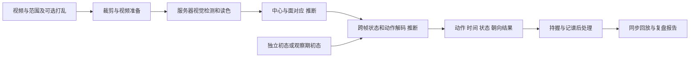

# solve.vision 技术调查与 Reconer 实现选择

**最有依据的架构判断是：可见色块检测与读色、中心和面几何对应、时序动作解码，再叠加朝向估计及记谱后处理。** 它与 Reconer 的 A「可见实例与物理搜索」路线最接近。这个判断描述技术家族；公开信息还不能确定其检测器是 YOLO、Mask R-CNN、关键点网络还是其它组合，也不能确定它使用哪种搜索算法。

核对日期为 2026-10-27（America/Los_Angeles）。项目对照提交为 `8f3eb49dc492da1f8bb651d2fa14d10d5ad4fd64`。公开响应的 URL、取得时间、字节数和 SHA-256 见 [来源清单](2026-10-27-solve-vision-sources.json)。网页、客户端代码、示例结果与项目内作者回复转述的证据等级分别列明。

**哪些证据支撑这个判断**

| 证据 | 可以得出的结论 | 仍不能推出的结论 |
| --- | --- | --- |
| [官网](https://solve.vision/)要求色块清晰，提示其它魔方会干扰 detector，并支持遮罩 | 系统依赖可见的魔方图像信息，存在检测环节 | detector 的具体模型、是否逐色块实例分割 |
| [项目记录](../plan.md)保存用户转述：作者主要读出至少两个中心，再确定其它色块 | 作者描述的主方法重视中心和面身份；这条是二手转述 | 两个中心如何检测、每帧是否必需、如何求连续姿态 |
| [示例结果](https://solve.vision/media/solve-1.json)保存初态、每步后的 54 格状态、动作时间及连续朝向矩阵 | 输出存在显式魔方状态和朝向表示 | 状态一定参与后端搜索；这些状态也可能由已预测动作再计算 |
| [官网](https://solve.vision/)说明独立打乱更可靠，也能尝试从观察期恢复初态 | 初态是产品输入的一部分，未知初态有单独处理模式 | 从视频恢复拍摄前真正执行过的打乱历史，或一定使用逆向 beam search |
| [结果页脚本](https://solve.vision/src/report.js)读取异步任务状态；[隐私说明](https://solve.vision/privacy)明确服务器 worker 处理视频 | 识别任务在服务器异步执行，网页读取结果 | worker 的语言、推理框架、GPU、耗时或费用 |
| [上传页](https://solve.vision/upload)提供训练与人工审核选择；隐私说明涉及视频、修正和失败分类 | 产品已设计训练、评估与人工反馈的数据流程 | 使用了多少训练数据、具体损失函数或模型准确率 |

综合这些证据，我倾向于下面的内部处理链。中间的几何和状态约束细节是推断，末端的公开结果和前端处理则可以直接核对。

两个相邻中心的颜色与面几何对应明确时，可以帮助消除离散面朝向歧义。但两个彩色点本身不足以恢复透视网格、连续三维姿态或遮挡色块。中心短时消失后的跟踪、保留多个朝向候选和拒判，是我们可实现的衔接方案，不是已获证实的竞品内部实现。[项目对中心约束的说明](../plan.md)

**公开代码揭示了多少后处理**

[notation.js](https://solve.vision/src/notation.js)把连续朝向匹配到 24 种离散持握，再据此换算面名和插入转体记号。新持握需持续至少 120 ms 才确认；小于 250 ms 的短暂倾斜后回摆会被移除。这意味着输出的 `x/y/z` 可以来自连续朝向的规则处理，不必是视觉模型直接输出的动作类别。代码还明确说明选手视点是估计，没有头部或眼睛标定。

[cube.js](https://solve.vision/src/cube.js)对朝向做平滑与插值。朝向样本间隔超过 160 ms 时，先保持旧朝向，再在重新获取附近的 100 ms 内过渡；它并没有把所有丢失区间补成实测轨迹。公开示例暴露的是 3×3 旋转矩阵，没有对应的三维平移量，不能据此宣称完整 6DoF 跟踪。

同一文件把动作时间解释为转动完成时刻，并在其前方安排一段动画，动画时长受相邻动作间隔和播放速度限制。流畅的层转动画因此不等于测出了真实的逐帧转角、起转时刻或手指动作。这一实现属于公开回放模块，不能反过来当作服务器视觉算法的源码。

缺少相机轨迹时，[event-report.js](https://solve.vision/src/event-report.js)还有按动作频率估计持握的回退路径；[report-analysis.js](https://solve.vision/src/report-analysis.js)把 recognition time 对应为停顿时间估计。视点和“识别耗时”都需要按其定义理解，不能视为直接观测到选手视线和思考过程。

**五个示例的 Exact 应如何理解**

官网说明这五把使用已知打乱，动作序列与已发表复盘相符，时间约为 ±100 ms；也明确承认其它视频可能失败或只返回部分结果。这是成功示例展示，没有给出随机保留集上的一般成功率。[官网示例说明](https://solve.vision/)

下面统计的是公开 JSON 数组项数，不是自行运行模型得到的结果，也不是统一到某种 WCA 步数度量后的数量。

| 示例 | 页面成绩 秒 | `moves` 项数 | `canonicalMoves` 项数 | 朝向样本数 |
| --- | ---: | ---: | ---: | ---: |
| [1](https://solve.vision/media/solve-1.json) | 5.09 | 53 | 49 | 303 |
| [2](https://solve.vision/media/solve-2.json) | 3.96 | 54 | 53 | 150 |
| [3](https://solve.vision/media/solve-3.json) | 3.71 | 50 | 50 | 162 |
| [4](https://solve.vision/media/solve-4.json) | 3.84 | 47 | 47 | 162 |
| [5](https://solve.vision/media/solve-5.json) | 3.37 | 43 | 43 | 138 |

第一把可看到 `R R2` 对应规范化后的 `R'`，`F F` 对应 `F2`，以及连续三个 `D'` 对应 `D`。这包含状态等价合并，会改变事件数量；不能只当作不同撇号字符的排版统一。差异本身不证明识别错误，也不能单凭它断言官网 Exact 使用哪套比较规则。它证明我们必须区分原始动作事件、状态等价序列、转体表示和时间精度，而不能用一个“正确”标签覆盖所有层面。[示例 1 数据](https://solve.vision/media/solve-1.json)

Reconer 的目标是恢复实际执行过程。因此，原始事件分数和时间误差应作为主评价，规范化后的状态等价匹配另报；`U U` 与 `U2` 是否允许等价，要在看结果前与 GT 约定。现有 [plan.md](../plan.md) 还要求在 50 fps 下按一个目标帧的时间容差验收，并把漏步、错步留在分母。它比竞品展示的约 ±100 ms 更严格，但两者统计定义不同，不能简单宣称相差五倍准确率。

**可以确认的网站技术栈**

| 部分 | 公开证据与判断 |
| --- | --- |
| Web 外壳 | 首页加载 `_framework/blazor.web.js`，响应带 `blazor-enhanced-nav`；可识别为 Blazor 生态。响应的 Server 为 nginx。不能据此确定识别 worker 也使用 .NET |
| 三维播放器 | [shared-replay.js](https://solve.vision/src/shared-replay.js)导入共用播放器，[cube3d.js](https://solve.vision/js/cube3d.js)直接导入 Three.js；属于展示层 |
| 视频元数据 | [video-quality.js](https://solve.vision/src/video-quality.js)使用 MediaInfo 读取源视频信息 |
| 本地视频准备 | [快速准备模块](https://solve.vision/dist/fast-upload.js)及其[共享 bundle](https://solve.vision/dist/video-shared-63NRHLYR.js)包含 Mediabunny 与 WebCodecs 相关代码；[软件压缩回退](https://solve.vision/dist/compress-video-software.js)加载 FFmpeg WASM，并使用 libx264 |
| 上传与调度 | [upload-chunks.js](https://solve.vision/src/upload-chunks.js)分块上传，结果页轮询异步任务状态；私有接口未作为本次取证入口 |
| 分析与结果 | [stored-analysis.js](https://solve.vision/src/stored-analysis.js)读取预计算的阶段分析；[示例 JSON](https://solve.vision/media/solve-1.json)提供动作、时间和状态；[event-report.js](https://solve.vision/src/event-report.js)处理部分结果状态 |

FFmpeg WASM 用于浏览器的视频准备，不是已确认的视觉推理后端。共用播放器出现 `gyroOffsets` 等智能魔方接口名，也不意味着视频复盘需要陀螺仪；它把相机朝向转换为播放器可接收的格式。

[上传界面](https://solve.vision/upload)当前列出 3×3、2×2、Pyraminx、Skewb、Megaminx、Square-1、FTO、4×4 和 5×5，但可选项不等于各项目已有相同质量证据。[upload.js](https://solve.vision/src/upload.js)还把观察期初态检测限制在 3×3；其它项目要求打乱。对多项目的统一 UI，不能反推它们共用一个识别网络。

**对我们选模型和写代码的实际影响**

这次证据支持优先做好可见色块、中心身份和时序对应；没有提供理由把现有 Mask R-CNN 基线立刻改名为“竞品同款”。A 路线内部至少有三种可替换实现，沿用同一套观测和评价接口即可比较。

| 实现 | 应学会什么 | 与已有失败相比必须改变什么 |
| --- | --- | --- |
| 实例分割加中心和面几何 | 可见前景、颜色、中心身份、面归属和可见性；保留当前 Mask R-CNN 作为首个基线 | 用原图独立标注微调；不能把旧网格或解法反投的遮挡标签当金标 |
| 轻量实例检测或分割加关键点头 | 保持同一语义输出，另预测中心、面角点或格位支持 | 先确认定位、遮挡和对应精度，再看是否满足速度预算；不能只比框的命中率 |
| 面与中心关键点加可见区域读色 | 先确定面几何，再从真实可见区域取得颜色证据 | 对遮挡、转动中非平面形态和重定位失败明确拒判，避免重走固定九宫格采到衣服、皮肤的旧路 |

三种实现都需要时间事件层和物理状态层。可训练的是可见性、中心/几何及动作完成候选；魔方置换规则继续复用已有代码。它们可以是多个模型，也可以在证据支持后共享骨干，不要求从零训练一个巨型端到端模型。

当前应接续的代码位置与缺口如下；完整九条路线仍以 [implementation-paths.md](../implementation-paths.md) 为准。

| 模块 | 当前基础 | 接下来必须补的能力 |
| --- | --- | --- |
| 视觉观测 | `vision/baseline.py` 已写实例训练和流式预测入口 | 原片与独立实例 GT、训练后的权重；当前没有新模型成绩 |
| 中心与面几何 | `src/visible-geometry.ts` 可消费有来源的几何 | 自动中心与角点生产器、跨面共同姿态、遮挡后重新定位 |
| 时间 | `src/observation-timeline.ts` 产生变化区间 | 自动完成事件、可拆并候选及未知区间；不能直接拿动画时长作真实转动时长 |
| 解码 | `src/independent-reconstruction.ts` 复用物理搜索 | 从当前人工边界条件扩展到自动候选；未知初态和未复原终态分别实现与验收 |
| 评价与修正 | `src/evaluation.ts` 与复核队列 | 独立保留原始事件、规范化序列、姿态覆盖和完成时间评价，再接少量人工修正 |

之前动作特征分类受小样本和类别不平衡限制、启发式网格采样出现脱靶、弱观测进入搜索后误导候选，这些失败仍应避免。竞品线索支持换成可学习的可见实例和中心证据，并不证明扩大 beam 或更换模型名称就能解决它们。[既有失败与重试条件](../technical-options.md)

要进一步识别竞品的确切网络，需要作者直接披露、公开模型卡、权重或后端源码。目前所读页面与脚本没有给出可核实的具体架构，也不能确定训练集规模、推理设备、处理速度、是否用 PnP/RANSAC 或哪种搜索。对我们而言，下一步最有价值的是用用户提供的 GT 分别检验位置、中心/格位对应和时间候选，使路线选择由真实错误决定。

本次新增的是技术调查与来源记录。遵循本轮暂不测试的要求，没有上传用户视频、运行模型、训练、typecheck 或 benchmark，没有取得新权重；此前代码仍按 [实现记录](2026-10-24-design-and-integration.md) 所列边界等待验证。
